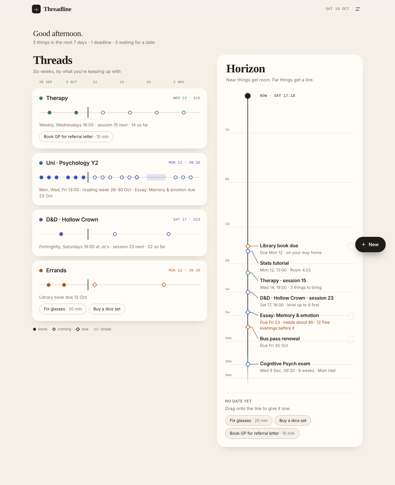
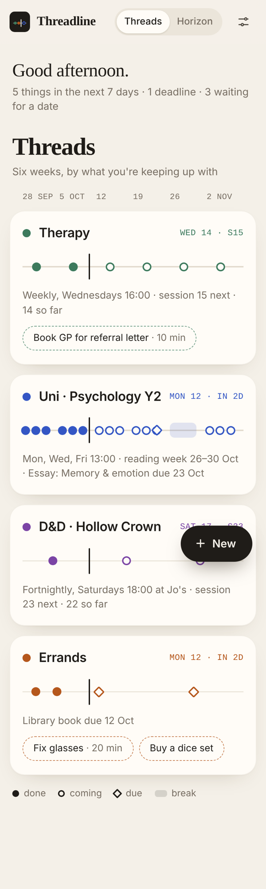
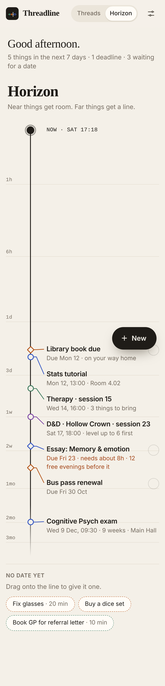

# Threadline

A calm calendar organised by what you're keeping up with, not by the date.

Threadline puts two views of the same plans side by side:

- **Threads** shows six weeks at a glance, one row per thing you keep showing up for (a class, therapy, a D&D campaign, errands). Filled dots are done, rings are coming up, diamonds are deadlines, and shaded blocks are breaks like a reading week.
- **Horizon** is a log-scale timeline from right now. The next few hours get lots of room, next month gets a line. Deadlines tell you how many free evenings you have before them.



<p>
  
  
</p>

## Features

- Recurring threads: weekly or every other week, on any days, with a time and place
- Numbered sessions ("session 15 next · 14 so far"), with the option to skip one without breaking the count
- Breaks such as reading weeks or holidays, shown on the timeline and left out of the count
- Events, deadlines and to-dos attached to a thread
- To-dos with no date sit in a tray; drag one onto the Horizon line to give it a date
- Deadlines with an hours estimate show how many free evenings you have left
- Per-session titles and notes ("Stats tutorial · Room 4.02", "3 things to bring")
- Undo for drags, deletes and ticking things off
- Light and dark themes (follows your system by default)
- Export and import a JSON backup
- Can be added to your phone's home screen like an app
- Everything is saved in your browser, nothing is sent anywhere

## Running it

There's no build step. Open `index.html` in a browser, or serve the folder:

```
python3 -m http.server
```

then visit http://localhost:8000.

## Putting it on GitHub Pages

1. Create a new repository and upload the contents of this folder.
2. Go to **Settings → Pages**.
3. Under **Build and deployment**, pick **Deploy from a branch**, choose `main` and `/ (root)`, and save.
4. After a minute your app is live at `https://<your-username>.github.io/<repo-name>/`.

## Files

```
index.html             page layout
style.css              all the styling, light and dark
app.js                 the app
manifest.webmanifest   install-as-app settings
icons/                 app icons
docs/                  screenshots for this readme
```

## Your data

Threadline stores everything in your browser's local storage under `threadline-data`. Clearing site data will remove it, so use **Settings → Export backup** now and then. The first time you open it you'll see some demo threads; use **Start empty** in settings to clear them.
